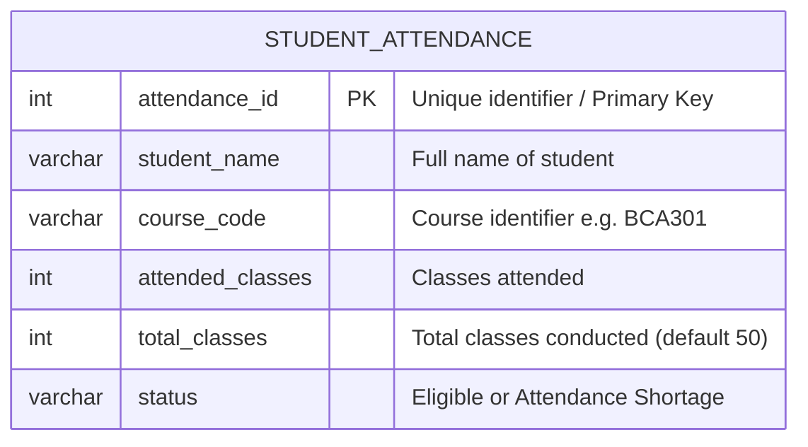

# Student Attendance Management System
### Java Swing GUI & JDBC Database Application — Reference Mini-Project

[](https://www.oracle.com/java/)
[-blue.svg)]()
[]()
[]()

A complete, production-ready desktop reference application developed for students. This project demonstrates best practices in building standalone Java desktop applications by integrating **Java Swing GUI (`javax.swing.*`)** with a relational database using **Java Database Connectivity (JDBC `java.sql.*`)**.

---

## 📸 Application Screenshot


---

## 📋 Table of Contents
1. [Overview & Features](#-overview--features)
2. [System Architecture](#-system-architecture)
3. [Database Schema & ER Design](#-database-schema--er-design)
4. [Project Directory Structure](#-project-directory-structure)
5. [Cybersecurity & Defensive Engineering](#-cybersecurity--defensive-engineering)
6. [Prerequisites & Requirements](#-prerequisites--requirements)
7. [Step-by-Step Setup & Execution](#-step-by-step-setup--execution)
8. [Component & Code Documentation](#-component--code-documentation)
9. [Viva-Voce Questions with Model Answers](#-viva-voce-questions-with-model-answers)
10. [Student Customization Checklist](#-student-customization-checklist)

---

## 🚀 Overview & Features

* **Desktop GUI Interface:** Built with clean, native Java Swing layouts (`BorderLayout`, `GridBagLayout`, `GridLayout`, and `FlowLayout`) providing an ergonomic two-pane workflow.
* **Full CRUD Operations:**
  * **Create (Insert):** Adds new attendance records with real-time field validation.
  * **Read (Search & Filter):** Query records instantly by Primary Key ID or filter live records in real-time across student names and course codes.
  * **Update:** Modify existing attendance numbers, recalculate attendance percentage dynamically, and update records with confirmation guards.
  * **Delete:** Remove records safely using confirmation dialogs.
* **Live Interactive Table (`JTable`):** Displays all database records with custom status rendering (Green for **Eligible**, Red for **Attendance Shortage**). Clicking any row automatically populates the form for rapid editing.
* **Dynamic Analytics & Status Bar:** Real-time counters showing Total Records, Eligible Count, Shortage Count ($< 75\%$), and live database connection health.
* **Modular 3-Tier Architecture:** Complete separation of concerns between Model (POJO), Data Access Object (DAO), Configuration, and Presentation (UI).
* **Self-Contained Edition Included:** Includes both modular source code (`src/`) and a single-file edition (`standalone/StudentAttendanceApp.java`) for flexible submission needs.

---

## 🏗️ System Architecture

The application adopts a decoupled **Model-View-Controller (MVC) / DAO** desktop architecture:

```mermaid
graph TD
    subgraph Presentation_Layer [1. Presentation Layer (Swing GUI)]
        UI[StudentAttendanceUI Window]
        FORM[Form Inputs & Key Listeners]
        TBL[Interactive JTable with Row Selection]
        BAR[Live Status & Summary Counters]
    end

    subgraph Business_Logic [2. Business & Validation Layer]
        VAL{Input Validation & Type Checking}
        CALC[Attendance % & Status Calculator]
        MODEL[StudentAttendance Entity Bean]
    end

    subgraph Data_Access_Layer [3. Data Access Layer (JDBC)]
        DAO[StudentAttendanceDAO Interface]
        PSTMT[PreparedStatement Parameterized SQL]
        CONN[DatabaseConfig Connection Manager]
    end

    subgraph Storage_Engine [4. Relational Database Engine]
        DB[(PostgreSQL / MySQL on localhost)]
        TBL_DATA[student_attendance Table]
    end

    UI --> FORM
    UI --> TBL
    FORM -->|User Input| VAL
    VAL -->|Valid Data| CALC
    CALC --> MODEL
    MODEL --> DAO
    DAO --> PSTMT
    CONN --> PSTMT
    PSTMT -->|Execute SQL| DB
    DB --> TBL_DATA
    TBL_DATA -->|ResultSet| DAO
    DAO -->|Mapped Entities| TBL
    DAO -->|Aggregates| BAR
```

---

## 🗄️ Database Schema & ER Design

### Entity-Relationship Diagram



### Table Definition (PostgreSQL / MySQL)

```sql
CREATE TABLE IF NOT EXISTS student_attendance (
    attendance_id INT PRIMARY KEY,
    student_name VARCHAR(100) NOT NULL,
    course_code VARCHAR(20) NOT NULL,
    attended_classes INT NOT NULL CHECK (attended_classes >= 0),
    total_classes INT NOT NULL DEFAULT 50 CHECK (total_classes > 0),
    status VARCHAR(30) NOT NULL
);

-- Performance Indexes
CREATE INDEX IF NOT EXISTS idx_student_name ON student_attendance(student_name);
CREATE INDEX IF NOT EXISTS idx_course_code ON student_attendance(course_code);
CREATE INDEX IF NOT EXISTS idx_status ON student_attendance(status);
```

---

## 📁 Project Directory Structure

```text
Mini_Project_Reference/
├── .gitignore                      # Git exclusion rules (ignores .class, bin/)
├── compile_and_run.bat             # 1-Click build & execution script for Windows CMD
├── compile_and_run.ps1             # 1-Click build & execution script for PowerShell
├── compile_and_run.sh              # 1-Click build & execution script for Linux/macOS
├── README.md                       # Complete documentation with embedded screenshots
├── assets/
│   └── screenshot.png              # High-resolution screenshot of the running UI
├── db/
│   ├── schema_postgresql.sql       # PostgreSQL DDL table script
│   ├── schema_mysql.sql            # MySQL DDL table script
│   └── seed_data.sql               # Initial sample data for testing
├── lib/
│   ├── postgresql.jar              # PostgreSQL JDBC Driver 42.x
│   └── mysql-connector-j.jar       # MySQL Connector/J JDBC Driver 8.x
├── standalone/
│   └── StudentAttendanceApp.java   # Single-file runnable reference edition
└── src/
    ├── Main.java                   # Main entry point launching on Swing EDT
    ├── config/
    │   └── DatabaseConfig.java     # Connection factory & auto-schema initializer
    ├── model/
    │   └── StudentAttendance.java  # Entity model with getters/setters & business rules
    ├── dao/
    │   └── StudentAttendanceDAO.java # Parameterized JDBC CRUD implementations
    └── ui/
        └── StudentAttendanceUI.java  # Two-pane modern Swing desktop interface
```

---

## 🔒 Cybersecurity & Defensive Engineering

| Threat / Vulnerability | Risk | Implemented Defensive Measure |
| :--- | :--- | :--- |
| **SQL Injection (SQLi)** | Attackers inject arbitrary SQL queries via input boxes to alter or extract records. | **Strict PreparedStatement Parameterization:** All queries use `?` placeholders. User input is never concatenated into raw SQL strings. |
| **Application Crash (Bad Inputs)** | Non-numeric inputs entered into ID or numeric fields cause unhandled runtime exceptions. | **Input Validation & Exception Trapping:** Explicit regex and `try-catch (NumberFormatException)` wrapping. Visual alerts via `JOptionPane` without crashing. |
| **Connection & Socket Leaks** | Abandoned database sockets exhaust database connection pool. | **Automatic Resource Cleanup:** Implemented using Java 7+ `try-with-resources` (`AutoCloseable`). Connections, statements, and result sets are guaranteed to close immediately upon exiting. |
| **GUI Freeze / Thread Starvation** | Creating Swing components on worker threads leads to UI freezing or race conditions. | **Event Dispatch Thread (EDT) Safety:** Frame initialization and updates are dispatched via `SwingUtilities.invokeLater()`. |

---

## ⚙️ Prerequisites & Requirements

* **Java Development Kit (JDK):** Version 11, 17 LTS, or 21+ (`javac` and `java` on system `PATH`).
* **Database Engine:** PostgreSQL (running on `localhost:5432`) **OR** MySQL (running on `localhost:3306`).
* **JDBC Driver:** Included in the `lib/` directory (`postgresql.jar` and `mysql-connector-j.jar`).

---

## 🛠️ Step-by-Step Setup & Execution

### Option 1: 1-Click Runner (Fastest)

#### On Windows (Command Prompt or File Explorer):
Double-click `compile_and_run.bat` or run:
```cmd
compile_and_run.bat
```

#### On Windows (PowerShell):
```powershell
.\compile_and_run.ps1
```

#### On Linux / macOS:
```bash
chmod +x compile_and_run.sh
./compile_and_run.sh
```

---

### Option 2: Manual Compilation from Command Line

```cmd
# 1. Navigate to the project root directory
cd Mini_Project_Reference

# 2. Create output directory
mkdir bin

# 3. Compile all source files
javac -cp ".;lib/*" -d bin src/config/*.java src/model/*.java src/dao/*.java src/ui/*.java src/Main.java

# 4. Run the application
java -cp "bin;lib/*" Main
```

---

### Option 3: Running the Standalone Single-File Edition

If you need to test or demonstrate using a single self-contained file:
```cmd
# Compile
javac -cp ".;lib/*" -d bin standalone/StudentAttendanceApp.java

# Run
java -cp "bin;lib/*" StudentAttendanceApp
```

---

## 💡 Component & Code Documentation

### 1. `DatabaseConfig.java`
Centralizes connection parameters and provides a helper method `initializeDatabase()` that automatically executes `CREATE TABLE IF NOT EXISTS`, ensuring the table is created automatically on first run.

```java
public static Connection getConnection() throws SQLException {
    return DriverManager.getConnection(URL, USER, PASS);
}
```

### 2. `StudentAttendanceDAO.java`
Encapsulates all database interactions into modular, reusable methods:
* `boolean insert(StudentAttendance record)`: Inserts a record.
* `StudentAttendance findById(int id)`: Fetches a single student by Primary Key.
* `boolean update(StudentAttendance record)`: Updates student information.
* `boolean delete(int id)`: Deletes record by Primary Key.
* `List<StudentAttendance> findAll()`: Retrieves all records ordered by ID.
* `List<StudentAttendance> search(String keyword)`: Matches by name or course code.

---

## 🎓 Viva-Voce Questions with Model Answers

### Q1. What are the key stages in establishing a JDBC connection?
**Answer:**
1. Load the database driver (automatically handled via JDBC 4+ SPI).
2. Establish connection using `DriverManager.getConnection(url, username, password)`.
3. Create a `PreparedStatement` with parameterized SQL.
4. Execute the statement using `executeUpdate()` (for DML) or `executeQuery()` (for SELECT).
5. Process the `ResultSet` if data is returned.
6. Close the connection and associated resources using `try-with-resources`.

### Q2. Why must we use `PreparedStatement` instead of `Statement`?
**Answer:**
1. **Security:** `PreparedStatement` uses parameter placeholders (`?`), ensuring user input is treated strictly as data literals and completely preventing SQL Injection attacks.
2. **Performance:** Pre-compiled once by the database engine, reducing execution overhead for repeated calls.

### Q3. What is the difference between `executeUpdate()` and `executeQuery()`?
**Answer:**
* `executeUpdate()` is used for DDL and DML operations (`INSERT`, `UPDATE`, `DELETE`, `CREATE TABLE`). It returns an integer representing the count of rows affected.
* `executeQuery()` is used exclusively for `SELECT` queries and returns a `ResultSet` object containing the fetched records.

### Q4. How does `ResultSet.next()` navigate database records?
**Answer:**
When a `ResultSet` is initially created, its cursor is placed before the first row. `rs.next()` moves the cursor forward to the next row. It returns `true` if a row exists, and `false` when the end of the result set is reached.

### Q5. What is the purpose of `try-with-resources` in JDBC?
**Answer:**
Database connections and statements consume operating system sockets. Wrapping them in `try-with-resources` (`AutoCloseable`) guarantees that they are closed automatically upon block exit—even if an exception occurs—preventing resource leaks and connection exhaustion.

### Q6. What is the role of `SwingUtilities.invokeLater()`?
**Answer:**
Java Swing is not thread-safe. `SwingUtilities.invokeLater()` submits GUI construction and rendering tasks to the Event Dispatch Thread (EDT), ensuring thread safety and preventing UI race conditions or visual glitches.

---

## 📝 Student Customization Checklist

To adapt this reference project to your assigned domain (e.g., Library, Hospital, Pharmacy, Banking):

1. **Update Table Name & Attributes:**
   * Open `db/schema_postgresql.sql` or `db/schema_mysql.sql`.
   * Replace `student_attendance` with your assigned table name (e.g., `library_books`).
   * Update column names and types to match your assigned specifications.
2. **Update Entity Model (`model/StudentAttendance.java`):**
   * Change field names, getters, setters, and constructors to reflect your domain attributes.
3. **Update DAO Layer (`dao/StudentAttendanceDAO.java`):**
   * Adjust SQL `INSERT`, `SELECT`, `UPDATE`, and `DELETE` queries to match your table columns.
4. **Update GUI Labels & Form Fields (`ui/StudentAttendanceUI.java`):**
   * Rename `JLabels`, text fields, window title, and `JTable` column headers.
5. **Recompile and Run:**
   * Execute `compile_and_run.bat` or `compile_and_run.ps1` to test your application.

---

## 📄 License
This project is open-source and available under the [MIT License](LICENSE).
