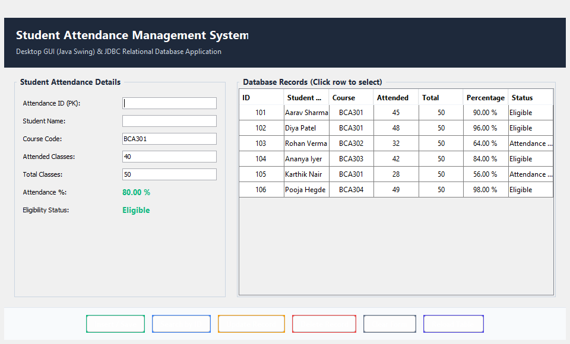

# Student Attendance Management System
### Java Swing GUI & JDBC Database Application — Reference Mini-Project

[](https://www.oracle.com/java/)
[-blue.svg)]()
[]()

A complete, beginner-friendly desktop reference mini-project. This project demonstrates how to build a standalone desktop database application combining **Java Swing GUI (`javax.swing.*`)** with relational database connectivity (**JDBC `java.sql.*`**).

---

## 📸 Application Screenshot



---

## 📁 Simple & Clean Project Structure

This project is intentionally designed with a **single Java source file** so students have zero confusion about packages, folders, or classpaths:

```text
Mini_Project_Reference/
├── StudentAttendanceApp.java   <-- The ONLY file you need to read, modify, and submit
├── compile_and_run.bat         <-- Double-click to compile and run on Windows
├── compile_and_run.ps1         <-- PowerShell runner
├── compile_and_run.sh          <-- Linux / macOS runner
├── README.md                   <-- Guide and viva questions
├── assets/
│   └── screenshot.png          # Screenshot of running GUI
├── db/
│   ├── schema_postgresql.sql   # PostgreSQL table creation script
│   ├── schema_mysql.sql        # MySQL table creation script
│   └── seed_data.sql           # Sample data rows for testing
└── lib/
    ├── postgresql.jar          # PostgreSQL JDBC Driver
    └── mysql-connector-j.jar   # MySQL JDBC Driver
```

---

## 🚀 Key Features

* **Single-File Simplicity:** The entire program—GUI layout, event handling, and database CRUD—resides in `StudentAttendanceApp.java` (approx. 200–250 lines of clean, well-commented code).
* **Full CRUD Operations:**
  * **Insert / Save:** Reads form fields, validates inputs, and inserts records using `PreparedStatement`.
  * **Search by ID:** Finds a record by Primary Key ID, populates the fields, and highlights the matching table row.
  * **Update Record:** Modifies details of an existing record with a confirmation prompt.
  * **Delete Record:** Deletes a record by Primary Key with confirmation guard.
  * **Clear Form:** Resets all input boxes.
* **Live Interactive Table (`JTable`):** Displays all records from the database. Clicking any row in the table automatically loads that student's details into the form for editing.
* **Real-Time Dynamic Attendance %:** As you type the number of classes attended, the system instantly recalculates the percentage and updates the **Eligibility Status** badge (Green for $\ge 75\%$, Red for $< 75\%$).
* **Automatic Table Creation:** The program automatically runs `CREATE TABLE IF NOT EXISTS` upon launch, so you don't even need to manually create the table first.

---

## 🗄️ Database Schema & DDL

### PostgreSQL / MySQL Table Definition

```sql
CREATE TABLE IF NOT EXISTS student_attendance (
    attendance_id INT PRIMARY KEY,
    student_name VARCHAR(100) NOT NULL,
    course_code VARCHAR(20) NOT NULL,
    attended_classes INT NOT NULL,
    total_classes INT NOT NULL DEFAULT 50,
    status VARCHAR(30) NOT NULL
);
```

---

## 🛠️ How to Run

### Method 1: 1-Click Runner (Easiest)
* **Windows:** Simply double-click **`compile_and_run.bat`** (or run `.\compile_and_run.ps1` in PowerShell).
* **Linux / Mac:** Run `./compile_and_run.sh` in terminal.

---

### Method 2: Command Line (Manual)

Open terminal / command prompt in this directory:

```cmd
# 1. Compile
javac -cp ".;lib/*" StudentAttendanceApp.java

# 2. Run
java -cp ".;lib/*" StudentAttendanceApp
```

*(On Linux / macOS, use a colon `:` instead of a semicolon `;` for the classpath: `javac -cp ".:lib/*" StudentAttendanceApp.java`)*

---

### Method 3: In VS Code / Eclipse
1. Open this folder in your IDE.
2. Add `lib/postgresql.jar` (or `mysql-connector-j.jar`) to **Referenced Libraries** / **Build Path**.
3. Open `StudentAttendanceApp.java` and click **Run**.

---

## 🔒 Cybersecurity & Best Practices

1. **SQL Injection Prevention:**
   All queries use `PreparedStatement` with parameterized placeholders (`?`). User inputs are never directly concatenated into SQL strings.
   ```java
   // SAFE: Parameterized query
   String sql = "INSERT INTO student_attendance VALUES (?, ?, ?, ?, ?, ?)";
   PreparedStatement pstmt = conn.prepareStatement(sql);
   pstmt.setInt(1, id);
   pstmt.setString(2, name);
   ```

2. **Input Validation & Exception Trapping:**
   * Non-empty field validation prevents blank records.
   * `NumberFormatException` is trapped so entering text in ID or numeric fields displays a friendly dialog rather than crashing the program.
   * `SQLException` is caught and displayed via `JOptionPane.showMessageDialog`.

3. **Automatic Resource Cleanup:**
   Every database operation uses Java 7+ `try-with-resources`:
   ```java
   try (Connection conn = DriverManager.getConnection(URL, USER, PASS);
        PreparedStatement pstmt = conn.prepareStatement(sql)) {
       // Resources are automatically closed when this block exits!
   }
   ```

4. **Thread Safety in Swing:**
   GUI initialization is always dispatched onto the Event Dispatch Thread (EDT) via `SwingUtilities.invokeLater()`.

---

## 📝 How Students Adapt This to Their Assigned Project Topic

Every student has been assigned a specific domain (e.g., *Library, Hospital, Pharmacy, Bus Route, Supermarket, Bank*). To customize this template for your topic:

1. **Change the Class & File Name:**
   * Rename `StudentAttendanceApp.java` to match your assignment: `<USN>_<ProjectTitle>.java` (e.g., `25UG00232_LibraryBookApp.java`).
   * Update the class name inside the file: `public class 25UG00232_LibraryBookApp extends JFrame { ... }`.
2. **Update Database Table & Column Names:**
   * Modify the SQL `CREATE TABLE`, `INSERT`, `SELECT`, `UPDATE`, and `DELETE` queries to match your assigned table (e.g., `library_books`).
3. **Update Text Fields & Labels:**
   * Change `txtCourse`, `txtAttended` to match your columns (e.g., `txtAuthor`, `txtPrice`).
   * Rename `JLabel` text strings.
4. **Update Table Column Headers:**
   * Adjust the `String[] columns = { ... }` array for the `JTable`.
5. **Compile and Test:**
   * Run `compile_and_run.bat` to verify your changes!

---

## 🎓 Top 10 Viva-Voce Questions with Answers

### Q1. What are the steps involved in executing a JDBC program?
**Answer:**
1. Load database driver (automatic in JDBC 4+).
2. Create connection using `DriverManager.getConnection(url, user, pass)`.
3. Create `PreparedStatement` with parameterized SQL.
4. Execute query using `executeUpdate()` (for INSERT/UPDATE/DELETE) or `executeQuery()` (for SELECT).
5. Process `ResultSet` (for queries).
6. Close connection and statements (handled automatically by `try-with-resources`).

### Q2. Why is `PreparedStatement` preferred over `Statement`?
**Answer:**
1. **Security:** It prevents SQL Injection by escaping input values through placeholders (`?`).
2. **Performance:** The SQL statement is pre-compiled by the database engine.

### Q3. What is the difference between `executeUpdate()` and `executeQuery()`?
**Answer:**
* `executeUpdate()` is used for DML statements (`INSERT`, `UPDATE`, `DELETE`) and returns the number of rows affected.
* `executeQuery()` is used for `SELECT` statements and returns a `ResultSet` containing matching rows.

### Q4. What is the purpose of `ResultSet.next()`?
**Answer:**
The cursor initially sits before the first row. `rs.next()` advances the cursor to the next row and returns `true` if a row exists, or `false` when there are no more rows.

### Q5. What is the role of `LayoutManager` in Swing?
**Answer:**
A `LayoutManager` automatically calculates the size and position of components inside a container (`JFrame`, `JPanel`) across different screen sizes and operating systems. Common layout managers include `BorderLayout`, `GridLayout`, and `FlowLayout`.

### Q6. How does an `ActionListener` work?
**Answer:**
`ActionListener` is an interface with one method: `actionPerformed(ActionEvent e)`. When a user clicks a `JButton`, the button fires an `ActionEvent` and triggers the registered listener code.

### Q7. What is `try-with-resources` and why is it used in JDBC?
**Answer:**
It ensures that database `Connection`, `PreparedStatement`, and `ResultSet` objects are closed automatically as soon as the try block finishes, preventing database connection leaks.

### Q8. What is the difference between AWT and Swing?
**Answer:**
* **AWT:** Heavyweight components dependent on the underlying operating system's native windowing peers.
* **Swing:** Lightweight components written 100% in Java (`javax.swing.*`), platform-independent with customizable look and feel.

### Q9. Which exception is caught when a user types text into a numeric field?
**Answer:**
`NumberFormatException`. It is thrown by `Integer.parseInt()` or `Double.parseDouble()` when the input string cannot be parsed into a number.

### Q10. Why do we wrap GUI startup in `SwingUtilities.invokeLater()`?
**Answer:**
Swing components are not thread-safe. `SwingUtilities.invokeLater()` ensures that the GUI is constructed and updated on the Event Dispatch Thread (EDT), preventing UI flickering and concurrency race conditions.
